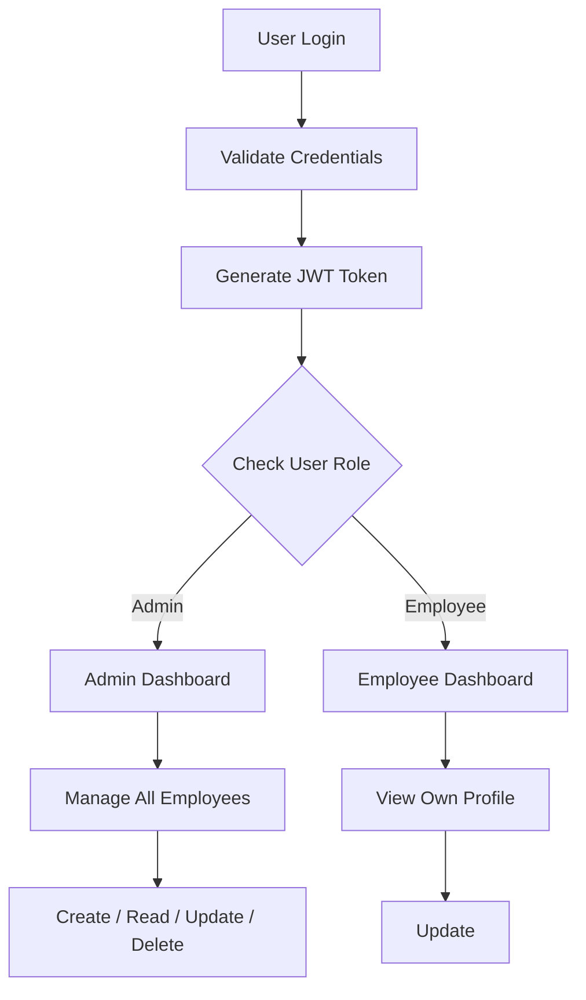

# Employee Management System – Project Design (ASP.NET Core Web API)

## 1. User Roles and Permissions

Initially, we will implement only **two roles**.

### 1.1 Admin

Full management access.

**Admin can:**

- Create a new employee and their login credentials.
- View all employees.
- View individual employee details.
- Update employee information.
- Delete or deactivate an employee.
- Search employees by name, designation or department.
- View employee salary and other confidential information.
- View total employees and department statistics.

### 1.2 Employee

Restricted access.

**Employee can:**

- Log in using their credentials.
- View their own profile.
- View their salary and designation.
- View their department and joining date.
- View their employment status.
- Update permitted personal information.
- Change their password.
- View their employment history.

**Employee cannot:**

- View other employees' information.
- Create or delete employees.
- Access Admin APIs.
- Modify their own salary or designation.

---

## 2. Database Design

**One important improvement:** Don't create separate Admin and Employee login tables.

Instead, create a **common `Users` table** for authentication and an **`Employees` table** for employee-related information.

This is a cleaner and more scalable database design.

I recommend **three main tables** initially.

### Table 1: Users

This table stores login credentials for both Admin and Employee.

| Column | Data Type | Description |
|---|---|---|
| Id | int | Primary key |
| FullName | varchar | User name |
| Email | varchar | Unique email |
| PasswordHash | varchar | Hashed password |
| Role | varchar | Admin / Employee |
| IsActive | bool | Account status |
| CreatedAt | datetime | Account creation |

**Example data:**

| Id | FullName | Role |
|---|---|---|
| 1 | Sourabh | Admin |
| 2 | Rahul | Employee |
| 3 | Aman | Employee |

### Table 2: Employees

This table stores employee professional information.

| Column | Data Type | Description |
|---|---|---|
| Id | int | Primary key |
| UserId | int | FK → Users.Id |
| EmployeeCode | varchar | Unique employee ID |
| Designation | varchar | Job designation |
| Department | varchar | Department |
| Salary | decimal | Monthly salary |
| JoiningDate | datetime | Joining date |
| ExperienceYears | decimal | Experience |
| PhoneNumber | varchar | Contact |
| Address | varchar | Address |
| EmploymentType | varchar | Full-time / Intern / Contract |
| ManagerName | varchar | Reporting manager |
| CreatedAt | datetime | Record creation |
| UpdatedAt | datetime | Last update |

**Example data:**

| EmployeeCode | Designation | Department | Salary |
|---|---|---|---|
| EMP001 | Backend Developer | IT | 35000 |
| EMP002 | HR Executive | HR | 28000 |
| EMP003 | Software Engineer | IT | 45000 |

### Table 3: Roles (optional initially)

If you want a more scalable design, create a separate `Roles` table.

| Id | RoleName |
|---|---|
| 1 | Admin |
| 2 | Employee |

Then replace the `Role` column in `Users` with `RoleId` as a foreign key.

> For your first version, a Role enum or string is sufficient. You can introduce a separate `Roles` table later.

---

## 3. Database Relationship

```
Users
  Id · FullName · Email · PasswordHash · Role
        │
        │  One-to-zero-or-one
        ▼
Employees
  Id · UserId (FK) · Salary · Designation · Department
```

An **Admin** has a `Users` record but **no** `Employees` record.
Each **Employee** has one `Users` record and one `Employees` record.

### When Admin creates an employee

1. Create the login account in `Users`.
2. Hash the password.
3. Assign the `Employee` role.
4. Create the professional profile in `Employees`.
5. Link both records using `UserId`.

> Perform these operations inside a **database transaction** so you don't end up with an account without an employee profile.

---

## 4. API Endpoints and Authorization

This is the most important part of the project because you will apply the **Authentication and Authorization** concepts you have learned.

### 4.1 Authentication APIs

| Method | Endpoint | Access |
|---|---|---|
| POST | `/api/auth/login` | Public |
| POST | `/api/auth/register` | Admin only |
| POST | `/api/auth/change-password` | Authenticated |
| POST | `/api/auth/refresh-token` | If implementing refresh tokens |

> **Note:** Don't allow public registration as Admin. Initially, seed the first Admin account securely.

### 4.2 Admin APIs

All these endpoints require `[Authorize(Roles = "Admin")]`.

| Method | Endpoint | Function |
|---|---|---|
| POST | `/api/admin/employees` | Create employee |
| GET | `/api/admin/employees` | Get all employees |
| GET | `/api/admin/employees/{id}` | Get single employee |
| PUT | `/api/admin/employees/{id}` | Update employee |
| DELETE | `/api/admin/employees/{id}` | Deactivate employee |
| GET | `/api/admin/dashboard` | Dashboard statistics |

### 4.3 Employee APIs

All these endpoints require `[Authorize(Roles = "Employee")]`.

| Method | Endpoint | Function |
|---|---|---|
| GET | `/api/employee/me` | Get own profile |
| PUT | `/api/employee/me` | Update permitted details |
| GET | `/api/employee/me/history` | Get employment history |
| POST | `/api/employee/me/change-password` | Change password |

### 4.4 Important Security Concept

Suppose Rahul has logged in. His JWT contains:

```json
{
  "sub": "2",
  "email": "rahul@gmail.com",
  "role": "Employee"
}
```

When Rahul calls:

```
GET /api/employee/me
```

Your backend should **extract the logged-in user's ID from the JWT claims** and retrieve Rahul's employee record.

> **Don't accept a `userId` from the frontend** to decide whose profile to return. Otherwise, an employee might try accessing someone else's data.

This is an important real-world security practice.

---

## 5. Additional Features I Recommend

Let's divide features into three levels so that the project remains manageable.

### Level 1 – Core Features (Must build)

- [ ] Admin and Employee login
- [ ] JWT Authentication
- [ ] Role-Based Authorization
- [ ] Employee CRUD
- [ ] Employee profile
- [ ] Password hashing
- [ ] Employee-specific data access

### Level 2 – Real-world Features (Recommended)

- [ ] Employee search and filtering
- [ ] Pagination and sorting
- [ ] Department management
- [ ] Soft delete (`IsDeleted` / `IsActive`)
- [ ] Employee profile update
- [ ] Salary and designation update restrictions
- [ ] Global exception handling
- [ ] Logging and audit records

### Level 3 – Advanced Features (Later)

- [ ] Leave management
- [ ] Attendance management
- [ ] Monthly salary slips
- [ ] Employee document upload
- [ ] Email notifications
- [ ] Refresh token rotation
- [ ] Multiple departments and reporting managers

> **My recommendation:** Complete Level 1 and Level 2 first. Don't start attendance and payroll until your core application is working properly.

---

## 6. Production-Oriented Folder Structure

Since you're learning ASP.NET Core Web API, I recommend this structure:

```
EmployeeManagementSystem/
│
├── Controllers/
│   ├── AuthController.cs
│   ├── AdminController.cs
│   └── EmployeeController.cs
│
├── Data/
│   └── ApplicationDbContext.cs
│
├── Models/
│   ├── User.cs
│   └── Employee.cs
│
├── DTOs/
│   ├── Auth/
│   │   ├── LoginRequestDto.cs
│   │   └── LoginResponseDto.cs
│   ├── Employee/
│   │   ├── CreateEmployeeDto.cs
│   │   ├── UpdateEmployeeDto.cs
│   │   └── EmployeeResponseDto.cs
│   └── Profile/
│       └── UpdateProfileDto.cs
│
├── Interfaces/
│   ├── IAuthService.cs
│   └── IEmployeeService.cs
│
├── Repositories/
│   ├── IEmployeeRepository.cs
│   └── EmployeeRepository.cs
│
├── Services/
│   ├── AuthService.cs
│   └── EmployeeService.cs
│
├── Middleware/
│   └── GlobalExceptionMiddleware.cs
│
├── Helpers/
│   └── JwtHelper.cs
│
├── Migrations/
│
├── Program.cs
└── appsettings.json
```

**Tech stack you can use:**

- ASP.NET Core Web API
- Entity Framework Core
- MySQL
- JWT Bearer Authentication
- Role-Based Authorization
- Swagger / OpenAPI
- Repository Pattern
- Service Layer
- Dependency Injection

---

## 7. How the Complete Application Will Work

The application flow:

